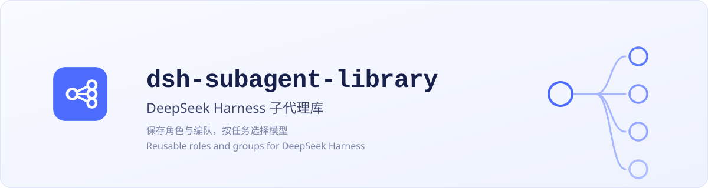

# dsh-subagent-library

**[中文](./README.md) | English**

<p align="center">
  
</p>

<p align="center">
  
  
  
</p>

## Overview

Save the roles you use often in DeepSeek Harness Desktop or Web. For example, create a role called “Code reviewer”, choose its model and prompt, then say “Ask Code reviewer to check these changes.” Groups let you reference those same roles by slot and give each slot its own assignment.

**Groups work with Agent Teams switched off.** Each delegation starts one native child and returns its host-assigned name. The parent can dispatch independent assignments in the same turn with one call per member. It can wait for a member's findings when another assignment depends on them. The host delivers each completion to the online parent. Enabling Agent Teams also gives the tree access to the official shared task board.

Version 0.4.0 targets DSH `0.2.2-rc.5` and requires native subagents that can be addressed by name for follow-up messages. To upgrade from an earlier version, see the [migration guide](./MIGRATION.md) and [changelog](./CHANGELOG.md).

## Install

### Desktop client (recommended)

Desktop and Web have separate plugin installations and activation states; installing for Web does not enable the desktop plugin. The desktop GUI route needs no PATH setup.

1. In the desktop sidebar, open **Plugins** → **Add plugin**.
2. Enter the npm package name `dsh-subagent-library@latest` and install it.
3. Click **Enable now** when installation finishes. Closing the completed-install dialog leaves the plugin disabled.
4. Restart only if the UI asks you to: fully exit with **Quit** in the application menu, then reopen the app. Closing a window may only hide it.

Once enabled, open **子代理库 (Subagent Library)** in Settings and choose the role roster or groups tab. The storage and backup section shows the roster directory.

<details>
<summary>Alternative: use the desktop-bundled CLI (Windows / macOS)</summary>

Start the desktop client once to initialize it. In the application menu, open **Manage dsh Command…** → **Install** to register its bundled `dsh` command, then open a new terminal. If the UI reports a PATH conflict, follow its instructions first.

Fully exit the desktop client with **Quit**, then use the newly registered desktop-bundled CLI:

```sh
dsh plugin --profile desktop add dsh-subagent-library@latest
dsh plugin --profile desktop list
```

Reopen the desktop client afterwards. An npm-installed `dsh` or `npx` cannot manage the `desktop` profile. See the [official desktop command documentation](https://github.com/deepseek-ai/deepseek-harness/blob/dsh-v0.2.1-rc.2/apps/desktop/README.md#bundled-command-runtime).

</details>

### Web

These commands manage Web plugins only. Use the same `dsh` CLI that starts your Web instance, matching that host's version, to install the stable release from npm:

```sh
dsh plugin --profile web add dsh-subagent-library@latest
```

After installation, stop the running `dsh web` process, start `dsh web` again with the same CLI, and refresh the page.

Other install sources:

```sh
# From GitHub (lib/ build artifacts are committed; no local build needed)
dsh plugin --profile web add github:MaRi23333/dsh-subagent-library

# From a local checkout
git clone https://github.com/MaRi23333/dsh-subagent-library.git
cd dsh-subagent-library
pnpm install && pnpm run build
dsh plugin --profile web add /absolute/path/to/dsh-subagent-library
```

> The repo commits `lib/` build artifacts, so git installs need no local build; after
> changing sources run `pnpm run build` and restart Web.
> Roster edits (files under `~/.dsh/subagents/`) are **hot-reloaded** — no restart.
>
> **Switching channels** — if you previously installed from GitHub or a local checkout and want npm-release upgrades, re-add with `dsh plugin --profile web add dsh-subagent-library@latest` to force the latest npm version.

## Your first delegation

Open the Subagent Library in Settings, switch to the role roster, and create a role with ID `text-helper` and a description. Leave the route empty to use the session model. You can also create the equivalent `text-helper.yaml` in the roster directory (default `~/.dsh/subagents/`).

```yaml
description: Organize text supplied by the parent.
persona: Preserve proper names from the source.
```

Ask the main agent to call `list_subagents()`, then `delegate({library_id:"text-helper", prompt:"Number apple, banana and pear in their original order."})`. The receipt's `name` addresses the native member. The parent receives the result separately. You can also manage roles in Settings.

## Groups and slots

Open the Groups tab, create a group with an ID and description, then select a role and give each member a unique code. A role can appear more than once, with a different assignment for each member. Save the group to make it available for dispatch. The equivalent file is `_groups/text-review.yaml` under the roster directory. The YAML field `slot` holds the member code.

```yaml
description: Extract facts and open questions from supplied material.
instructions: Include the source for each finding.
members:
  - slot: facts
    role: text-helper
    assignment: Extract facts supported by the source.
  - slot: questions
    role: text-helper
    assignment: Identify missing information.
```

| Action | Tool call |
| --- | --- |
| Browse groups | `list_subagents({kind:"groups"})` |
| Inspect member keys, model settings and assignments | `list_subagents({group_id:"text-review"})` |
| Dispatch one member | `delegate({group_id:"text-review", slot:"facts", prompt:"Check the paragraph above."})` |

Browsing starts zero agents. The `questions` slot starts only on a separate call selecting it. A direct dispatch sends the role persona and task. A group dispatch also includes group instructions and the selected slot's assignment in the child's first message. Each start resolves the current role and profile route. Existing children keep their own sessions. Use `/subagent` to inspect the roster and groups from the command palette.

Use `/subagent groups text-review` to see which members have a configured model and which inherit the parent model. A role can inherit the model and set its own reasoning effort. After dispatch, the native subagent menu and `list_agents` show the launch model and known effort in the member description, for example `text-review/facts [model-a · high]`. Expand the `delegate` receipt for the full `provider`, `model` and `reasoningEffort` values when available.

To change the model for one dispatch, open Plugins in the DSH sidebar, open the built-in Subagent configuration and enable Model selection. Select the allowed models, save, and start a new parent session. Ask the parent to use the role default for one member and an authorized model for the other. It can discover choices with the native `list_subagent_models` tool and pass both `provider` and `model` to `delegate`. The optional `reasoning_effort` selects an effort for that model. Omitting it uses the selected model's default. Subsequent dispatches use the saved role settings again.

In a session without a recorded allowlist, an explicit selection is limited to the current parent provider and model. On a host that cannot read authorization, dispatch with the saved role settings remains available. Agent Teams is optional.

## Configuration and migration

| Location or field | Behavior |
| --- | --- |
| `<entriesDir>/<role-id>.yaml` | Shared role with required `description`. Optional fields include `persona`, `enabled`, model route, `maxTokens`, `maxDepth` and `subagentProvider`. |
| `_profiles/<profile>/<role-id>.yaml` | Profile route with `provider`, `model`, `reasoningEffort` or explicit inheritance. A shared provider missing from the current profile falls back to the session model. An invalid explicit profile route blocks the affected role. |
| `_groups/<group-id>.yaml` | Required description and ordered nonempty `members`. Optional `name`, `enabled` and `instructions`. A member has a `slot`, a `role` and an optional `assignment`. |
| `maxDepth` | Defaults to the host limit. An explicit value can tighten it. Zero blocks delegation. |
| `subagentProvider` | Defaults to the `spawn` transport. `fork` can inherit completed turns from the parent. The LLM provider is configured separately. |
| Legacy `backgroundMode` and `toolFilter` | Both former execution modes now start a resumable child asynchronously. Roles carrying a tool filter remain blocked until its removal is explicit. Set any required permission boundaries in the host. |

On hosts with profiles, Settings saves model edits in the current profile. On hosts without profiles, the same editor changes the shared default route. Clear it to follow the session model. Profile overrides bound to the old shared route need to be set again after the default changes.

IDs and slot keys use lowercase letters, digits and hyphens, start with a letter or digit, and are at most 64 characters. Windows reserved device names are excluded. Disabling a group leaves its enabled roles available for direct use. Remove all group references before deleting a role. Settings detect stale writes. Hand-edited YAML is read on the next operation.

Configure the base directory and default transport on the plugin row of the current profile's `cordis.patch.yml`:

```yaml
- id: subagent-library
  config:
    entriesDir: ~/.dsh/subagents
    subagentProvider: spawn
```

Include the role files, `_profiles/` and `_groups/` in backups. The Settings endpoint `/subagent-library/api` shares the DSH Web Host access boundary. Configure host or reverse-proxy authentication when exposing it to other devices.

## Development

```sh
pnpm install
pnpm run typecheck
pnpm run build   # host: lib/index.js; client: lib/client.js
```

- Dev dependencies remain pinned to DSH `0.1.0-rc.6` (see package.json devDependencies); this is not the current runtime host version. If the interfaces drift on other versions, adjust against the corresponding tag of the [deepseek-harness repo](https://github.com/deepseek-ai/deepseek-harness).

## License

[Apache-2.0](./LICENSE). Third-party license notices for code inlined into the build artifacts are in [THIRD_PARTY_NOTICES.md](./THIRD_PARTY_NOTICES.md).

This is an independent community project, not affiliated with or endorsed by DeepSeek; the `DeepSeek Harness` name is used only to identify the compatible platform.
