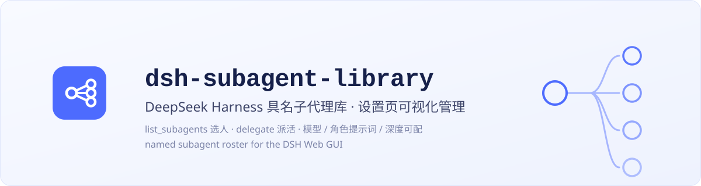
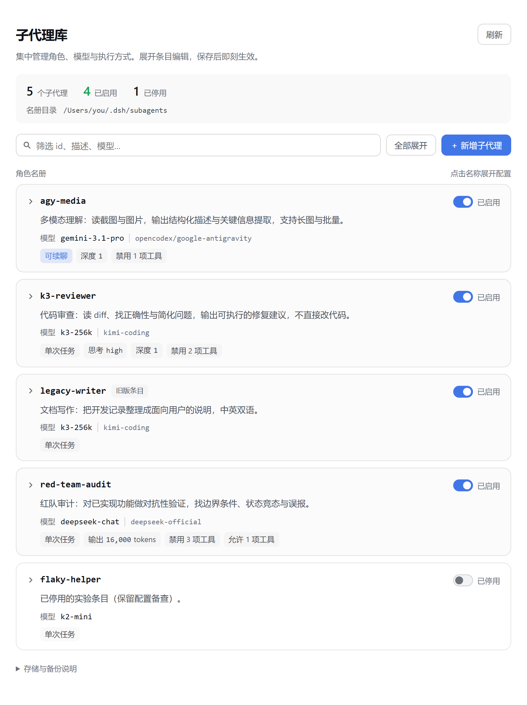
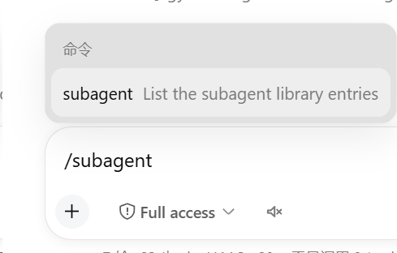
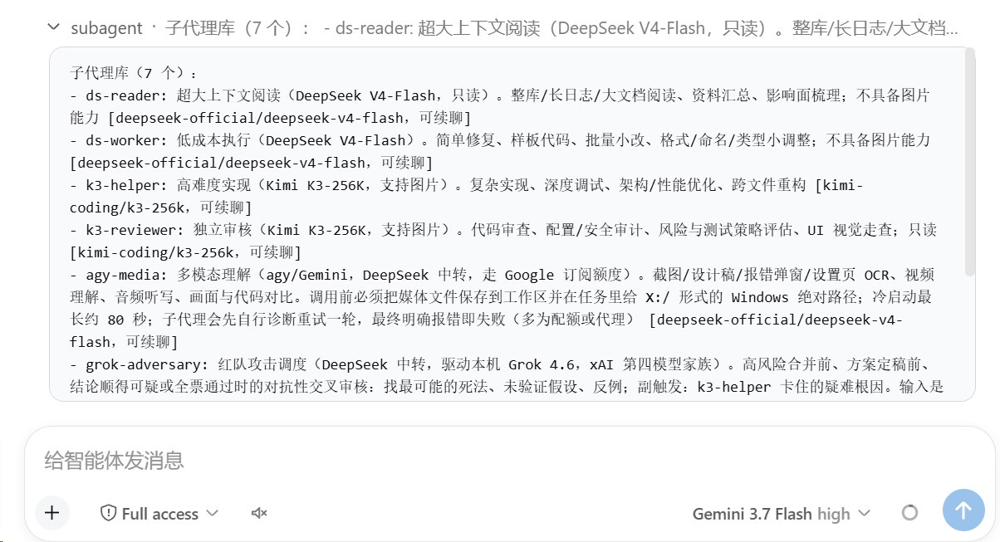

# dsh-subagent-library

**中文 | [English](./README.en.md)**

<p align="center">
  
</p>

<p align="center">
  
  
  
</p>

> **English:** dsh-subagent-library is a named subagent roster plugin for the
> [DeepSeek Harness](https://github.com/deepseek-ai/deepseek-harness) desktop and Web interfaces —
> manage role entries (model / role prompt / depth / background mode)
> from a settings page, hot-reloaded, then let any conversation pick one with
> `list_subagents` and dispatch work with `delegate`. See
> [README.en.md](./README.en.md) for the full English version.

## 简介

DeepSeek Harness 的具名子代理库插件：把常用角色（代码审查、红队、多模态理解……）配成一份持久化的具名子代理名册（模型、角色提示词、深度与后台模式），之后**只需告诉主会话 agent「用 xxx 做这件事」**——模型自己通过两个工具完成选人和派活：

- `list_subagents` — 列出名册条目（id / 角色描述 / 模型），模型据此挑选；
- `delegate` — 按 `library_id` 派活：前台等待、后台 one-shot 任务、或 continuable 可续聊子代理（按条目配置）。

任何会话（任意 agent preset）直接可用，**不需要 slash 命令**；`/subagent` 命令只是给人类在命令面板里快速查看名册用的。

新增条目也不用手写配置：直接让主会话 agent 帮你配，或在设置页里可视化编辑；0.3 起 名册存储为**一个具名子代理一个 YAML 文件**（默认目录 `~/.dsh/subagents/`），热生效、可单独注释与版本管理。

> 与官方能力的区分：官方 `subagent` 工具是临时派活（每次现场描述任务），官方 `list_agents` 列的是正在运行的子代实例；本插件维护的是**持久化的具名角色名册**（设置页可视化编辑、热生效），模型用 `list_subagents` 选人、`delegate` 按 id 派活。

> **从 0.2.x 升级？** 0.3 起名册目录化（一个子代理一个 YAML 文件），旧配置**自动迁移**；确认无误后可按宿主版本清除旧 `entries` 段。配置位置、失败重试和回滚边界见 [MIGRATION.md](./MIGRATION.md)，完整变更见 [CHANGELOG.md](./CHANGELOG.md)。

[安装](#安装) · [第一次委派](#第一次委派) · [配置参考](#配置)

## 宿主与桌面端兼容

**0.3.5 对齐 DSH `0.2.1-rc.2`**：修复可续聊子代理与一次性委派无法启动，以及后台任务取消未能停止子代理的问题。前台一次性、可续聊、后台启动及运行中取消已在该版桌面宿主中复验。角色提示词与工具过滤的限制见[配置](#配置)，完整变化见 [CHANGELOG.md](./CHANGELOG.md)。

桌面客户端沿用 Web 插件界面，无需另装桌面专用包。旧宿主的启动分支仍保留，但本轮实际运行验证以 `0.2.1-rc.2` 为准；模型调用仍取决于各 Provider 的配置与服务。名册目录、profile 路由和迁移规则不变，无需重新迁移。

## 安装

### 桌面客户端（推荐）

桌面客户端与 Web 的插件安装和启用状态各自独立；在 Web 安装不会自动在桌面端启用。桌面图形界面安装无需配置 PATH。

1. 打开桌面客户端，进入侧栏 **插件（Plugins）** → **添加插件（Add plugin）**。
2. 输入 npm 包名 `dsh-subagent-library@latest` 并安装。
3. 安装完成后点击 **立即启用（Enable now）**；只关闭安装完成对话框会让插件保持停用。
4. 仅在界面提示需要重启时，通过应用菜单 **退出（Quit）** 完整退出再重开。关闭窗口可能只是隐藏应用。

启用后可在设置中找到 **子代理库** 页面；页面顶部显示条目计数和名册目录。

<details>
<summary>备用：使用桌面随附 CLI（Windows / macOS）</summary>

先启动桌面客户端一次以完成初始化。在应用菜单打开 **Manage dsh Command…** → **Install**，注册桌面随附的 `dsh` 命令，再打开新终端；若界面报告 PATH 冲突，先按其提示处理。

通过 **Quit** 完整退出桌面客户端后，使用刚注册的桌面随附 CLI：

```sh
dsh plugin --profile desktop add dsh-subagent-library@latest
dsh plugin --profile desktop list
```

完成后重开桌面客户端。npm 安装的 `dsh` 和 `npx` 不能管理 `desktop` profile。命令注册说明见[官方桌面文档](https://github.com/deepseek-ai/deepseek-harness/blob/dsh-v0.2.1-rc.2/apps/desktop/README.md#bundled-command-runtime)。

</details>

### Web

以下命令只管理 Web 的插件。使用启动该 Web 实例的同一套、与宿主版本匹配的 `dsh` CLI，从 npm 安装稳定版本：

```sh
dsh plugin --profile web add dsh-subagent-library@latest
```

安装后停止当前 `dsh web` 进程，用同一套 CLI 重新运行 `dsh web`，再刷新页面。

其他安装来源：

```sh
# 从 GitHub 安装（仓库已提交 lib/ 构建产物，安装无需本地构建）
dsh plugin --profile web add github:MaRi23333/dsh-subagent-library

# 从本地目录安装
git clone https://github.com/MaRi23333/dsh-subagent-library.git
cd dsh-subagent-library
pnpm install && pnpm run build
dsh plugin --profile web add /absolute/path/to/dsh-subagent-library
```

> 仓库已提交 `lib/` 构建产物，git 安装无需本地构建；改源码后运行 `pnpm run build` 再重启 Web。
> 名册（`~/.dsh/subagents/` 下的条目文件）**热生效**，无需重启。
>
> **渠道切换**：之前从 GitHub / 本地目录安装、现在想跟随 npm 发布升级时，用 `dsh plugin --profile web add dsh-subagent-library@latest` 显式取 npm 最新版。

## 第一次委派

先确认当前主会话能正常与模型对话。本例沿用该会话的模型，只整理一段给定文字，无需另外配置 Provider 或文件、网页工具。

### 1. 创建最小角色

没有已有名册或旧配置时，列表为空，插件不会自动添加示例角色。

1. 打开 **设置 → 子代理库**。空库会直接显示新增表单；已有条目时点击 **＋ 新增子代理**。
2. 填写 **ID** 为 `text-helper`，**描述（模型可见）** 为 `整理主会话提供的短文本。`。若该 ID 已存在，换一个未使用的 ID，并同步替换下文示例。
3. **模型、Provider、角色提示词、禁用工具及其他选填项留空**，**后台模式**保持 `one-shot`，点击 **创建子代理**。这个按钮会直接保存，新条目默认启用，无需再点一次保存。

### 2. 让主会话列出并委派

回到主会话，发送：

```text
请先调用 list_subagents，确认有 text-helper；然后用 delegate 以前台方式将任务交给它：
把“苹果、香蕉、梨”按原顺序改成编号列表。只处理这段文字，不调用其他工具。
拿到子代理结果后转给我。
```

应看到 `list_subagents` 返回 `text-helper`，随后有一次 `delegate` 调用并返回子代理的编号列表。只有主会话直接回答、没有委派调用，还不能确认流程已经走通。`/subagent` 可以查看名册，但不会代替这次委派。

这次委派仍会调用模型服务；“不调用其他工具”是任务要求，工具权限由宿主控制。DSH 0.2.1 的逐条目 `toolFilter` 暂不可用，角色名或提示词也不是只读权限保证，详见[配置中的限制](#配置)。

### 3. 没走通时先看这几处

- **找不到条目**：确认已点“创建子代理”，在设置页点击“刷新”并检查诊断。若条目已停用，切为“已启用”后保存。
- **没有这两个工具**：确认插件在当前桌面或 Web 实例中启用，再检查当前会话的工具可用设置。
- **模型启动失败**：先确认主会话能正常回复；角色的 Provider 与模型均留空。不要把输入框里的灰色示例当成自己的路由；服务端鉴权、额度等错误按实际报错处理。

<details>
<summary>可选：用 YAML 创建同一个最小角色</summary>

文件方式和上面的界面方式二选一。在设置页显示的名册目录里新建 `text-helper.yaml`（目录不存在时先创建；不要覆盖已有同名条目）：

```yaml
description: 整理主会话提供的短文本。
```

ID 来自文件名；其他字段省略即可继承会话模型并默认启用。保存后热生效，无需重启。更多字段见[配置](#配置)。

</details>

## 界面

<p align="center">
  <br>
  <em>默认收起的名册卡片：一眼查看角色、模型与执行设置，筛选后展开编辑；启停修改保存后生效。</em>
</p>

<p align="center">
  <br>
  <em><code>/subagent</code> 命令（快速查看子代理库名册）</em>
</p>

<p align="center">
  <br>
  <em>名册输出示例：每个条目一句话角色描述 + 模型路由 + 可续聊标记</em>
</p>

## 设置页

打开 **设置 → 子代理库**：**每个条目是一张默认收起的卡片**，点击名称展开编辑。

- **分层卡片**：名称与启用开关位于首行，角色描述独占一段（最多两行），模型与 Provider 单独展示；可续聊、思考强度、深度、输出上限、角色提示词与工具限制统一排在下方。长名称和模型路由自动换行，标签不再挤占描述空间。
- **摘要带**常驻页面顶部：条目 / 启用 / 已停用 / 未保存计数 + 名册目录。
- **筛选框**匹配 id、描述、模型等，配合 全部展开 / 收起 在长名册里定位。
- **展开后**字段分组为「概述 / 路由与执行 / 工具与提示词」，宽面板两列、窄面板单列；底部是 还原 / 删除 / 保存。界面随宿主切换明暗主题，并支持键盘操作。
- 开关修改先保留为草稿：折叠卡片上会出现「未保存」提示和「还原 / 保存修改」，保存后才生效。保存一个条目不会提交其他条目的草稿；还原会完整恢复该条目的已保存配置。
- 停用条目在列表末尾显示；带「旧版条目」徽标的条目保存时自动晋升为文件。页面底部可展开存储与备份说明。

保存后的改动写回名册目录下的 `<id>.yaml`，热生效。

> **安全提示**：子代理库的设置接口（`/subagent-library/api`）遵循 DSH Web Host 的本地可信边界，插件自身不含独立身份验证层。若将 DSH Web 绑定到局域网 / 公网 / 反向代理，请在外层配置认证与访问控制，不要把该接口暴露给不可信客户端——子代理 persona 与配置可能包含内部工作规则。

## 配置

0.3 起，名册是一个目录，**一个具名子代理一个文件**（热生效，无需重启）：

```
~/.dsh/subagents/
  k3-reviewer.yaml     # id = 文件名
  glm-reader.yaml
  _backups/            # 备份区：agent/人改条目前先把原文件复制到这里（`_` 前缀内容插件忽略）
  README.md            # 可选：给操作本目录的 agent 看的约定说明
  ...
```

> **备份约定**：插件不做自动备份；按惯例，agent（或人）在修改条目前先把原文件复制进 `_backups/`（命名建议 `<id>.<yyyymmdd-hhmm>.yaml`）。`_` 前缀的文件/目录一律视为非名册内容，插件静默忽略。名册目录里可放一份 `README.md` 给操作该目录的 agent 立规矩。

上面的插件级配置存放位置**随宿主版本不同**。两种正确的配置形状如下：

**DSH ≤0.1.6：**编辑 `~/.dsh/settings.yaml`。

```yaml
subagent-library:
  entriesDir: ~/.dsh/subagents
  subagentProvider: spawn
  # entries:（可选，遗留）0.2.x 的内联名册在 0.3.x 仍只读兜底，文件优先生效；0.4 移除
```

**DSH ≥0.1.7：**编辑**当前 profile**（`web` 或 `desktop`）的 `cordis.patch.yml`，在 `- id: subagent-library` 的 `config` 下配置。desktop 与 web 的模型路由互不影响：共享名册里的 `provider` 若未在当前 profile 注册，调用会改用本会话模型；设置页保存的 Provider/模型只写入当前 profile。

```yaml
- id: subagent-library
  config:
    entriesDir: ~/.dsh/subagents
    subagentProvider: spawn
    # entries:（可选，遗留）0.2.x 的内联名册在 0.3.x 仍只读兜底，文件优先生效；0.4 移除
```

单个条目文件（`k3-reviewer.yaml`）：

```yaml
description: Kimi K3-256K 代码审查，支持图片视觉走查
provider: kimi-coding
model: k3-256k
persona: |
  你是运行在 Kimi K3-256K 上的独立审核 agent……
maxDepth: 1
backgroundMode: continuable
```

> **DSH 0.2.1 系列的限制**：角色提示词随首条任务消息发送，不是系统级权限约束；逐条目 `toolFilter` 暂不可用，含该字段的条目会拒绝委派。上面的示例因此不含工具过滤，**不保证只读**。有只读或工具隔离需求时，应先在宿主中配置相应权限，不能只靠角色名称或提示词。旧宿主的字段行为见下表。

条目字段：

| 字段 | 必填 | 说明 |
|---|---|---|
| `id`（= 文件名） | 是 | `<id>.yaml`，id 须匹配 `[a-z0-9][a-z0-9-]*`，长度 ≤ 64（Windows 保留设备名 con/nul/aux… 不可用） |
| `description` | 是 | 角色描述，`list_subagents` 展示给模型 |
| `provider` | 否 | **LLM 路由**（如 `deepseek-official`、`kimi-coding`）；缺省用调用方默认 |
| `model` | 否 | LLM 模型 id；缺省用调用方的会话默认模型 |
| `reasoningEffort` | 否 | 思考强度：适配器自有值（如 `max` / `high` / `medium` / `low`），留空随父会话默认。走官方 `agentOptions.reasoningEffort` 覆盖通道；子代理换了模型路由时官方会自动丢弃继承值，未显式设置不会跨模型泄漏。只接受 id 形态（字母数字与 `._-`），其他值保存时被拒绝 |
| `subagentProvider` | 否 | **子代理传输层**（`spawn` 等 `ctx.subagents` provider）；默认取插件级默认 `spawn` |
| `maxTokens` | 否 | 子代理输出上限 |
| `persona` | 否 | 子代理角色提示词。**DSH ≤0.2.0 宿主**：作为系统 persona 部署，走严格的 `{{…}}` 模板插值（与部署 persona 同语义）——出现未注册的变量（如 `{{user}}`）会让子代理激活失败。**DSH ≥0.2.1 宿主**：启动请求已无 persona 字段，角色以 `Role persona:` 前缀折叠进首条任务消息——首轮生效，但不遮蔽部署 persona；续聊回合与上下文压缩后不保证角色仍在；`{{…}}` 不再插值（原文拼接）。不采用独立 `agentPreset` 承载角色：独立 preset 会替换父 preset 组合、丢掉父会话工具 |
| `toolFilter` | 否 | `allow`/`deny` 工具名单（只读角色用 deny 禁写类工具）。**只读/受限角色建议把 `list_subagents`/`delegate` 也列入 deny**，防止子代理被全局提示词教去链式再派活。名单在**委派时按调用方会话的可限制集合**解析（不是"可见"）：不可应用的名字被忽略，并在派活结果与 `list_subagents` 目录里标注原因（`本会话不存在` / `本会话专属工具`）——共享条目不会因为某个会话缺该工具而整次派活失败。**`allow` 名单若在本会话全部不可应用则拒绝委派**（否则"只留这些"会变成"什么都不留"）。旧注册表无 `view()` 时退回可见性判定，此时 scope-local 名仍会让委派明确报错。保存阶段不做校验。**DSH ≥0.2.1 宿主无法强制执行逐条目工具过滤**：带 `toolFilter` 的条目会被委派直接拒绝（目录标注「无法强制执行」，保存时附警告）；这类条目只适用于 ≤0.2.0 宿主 |
| `maxDepth` | 否 | 委派深度上限；**缺省 = 传输层支持 depthLimit 时默认 3**（与官方 subagent 工具对齐，防链式递归派活；harness 自身无全局深度上限），不支持 depthLimit 的传输层则不设上限 |
| `backgroundMode` | 否 | `one-shot`（默认，文件中省略）/ `continuable`（可续聊） |
| `enabled` | 否 | 文件内写 `enabled: false` 停用该条目（目录与设置页仍可见，`delegate` 拒绝派活）；省略或 `true` 为启用 |

**坏文件不炸名册**：解析/校验失败的文件被跳过，错误进入 `list_subagents` 输出、`/subagent` 命令与设置页的 diagnostics；`.yaml`/`.yml` 同名冲突、大写文件名等也会以诊断形式报出。

**从 0.2.x 迁移**：首次使用名册时，旧配置里的 `entries` 会**逐条**导出为 `<id>.yaml`（已存在同名文件的条目跳过，绝不覆盖手写文件）；旧条目保留作回滚副本，文件优先生效。通过设置页保存时，规范 `.yaml` 内容未变时会跳过写入并保留手写注释；`.yml` 内容即使未变也会重写为生成的 `.yaml` 并移除 `.yml`，原注释会丢失。写入或收敛失败返回 HTTP 500，可能已有部分文件完成；规范 `.yaml` 的跳过路径若清扫同名 `.yml` 失败则返回 200 并带 warning，冲突诊断会持续到下次重试成功。确认无误后按宿主版本清除旧 `entries` 段（0.4 将停止读取）。

清理时只删除 `entries` 键：旧宿主保留同一 `subagent-library` 行的 `subagentProvider` / `entriesDir` 等其他键；新宿主保留同一 `config` 行的这些键，不要删除整个配置条目。0.2.8 的旧 `entries` 回滚副本只适用于 DSH ≤0.1.6；在 DSH ≥0.1.7 上不能单独降级插件。宿主降级和 `settings.yaml.imported` 数据恢复均未验证；如果需要恢复 0.3 名册内容，请从你自己建立的名册 `_backups/` 备份恢复并自行核对。

> 注意区分两个 provider 概念：`provider` 指 LLM 路由（`agentOptions.provider`），
> `subagentProvider` 指子代理传输层（`ctx.subagents` 注册名，如 `spawn`/`fork`/`acp`）。

## 设计说明

- 工具注册在 **host 平面**：不依赖任何 agent preset，切 preset 不会丢；
- 派发走标准 `ctx.subagents` 缝（spawn 等 provider），子代理沿用 harness 语义：审批固定 never、沙箱继承父会话、深度上限、continuable 支持；
- 名册每次操作实时读目录（无缓存、无 watcher），改文件立即生效；单条目写入为原子操作（临时文件 + rename 重试），多写者后写赢。

## 开发

```sh
pnpm install
pnpm run typecheck
pnpm run build   # host: lib/index.js；client: lib/client.js
```

- 开发依赖仍锁定 DSH `0.1.0-rc.6`（见 package.json devDependencies），不等于当前使用宿主版本；当前兼容范围与反馈见上方「宿主与桌面端兼容」。其他版本如接口漂移请对照 [deepseek-harness 仓库](https://github.com/deepseek-ai/deepseek-harness) 相应 tag 调整。

## License

[MIT](./LICENSE)。本仓库内联构建产物的第三方许可证声明见 [THIRD_PARTY_NOTICES.md](./THIRD_PARTY_NOTICES.md)。

本插件是独立社区项目，与 DeepSeek 无任何隶属或背书关系；`DeepSeek Harness` 名称仅用于标明兼容平台。
