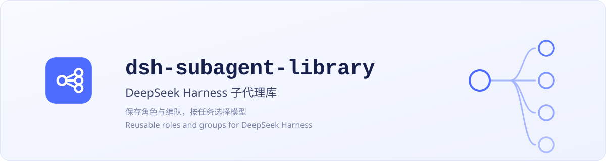
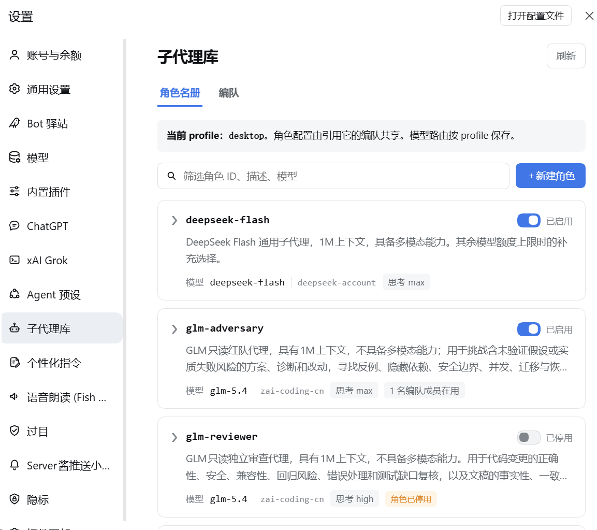
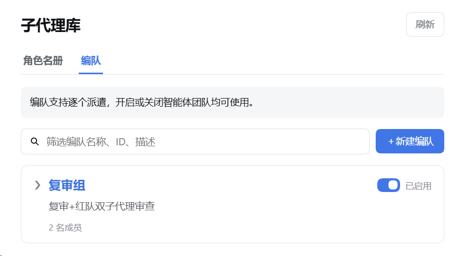
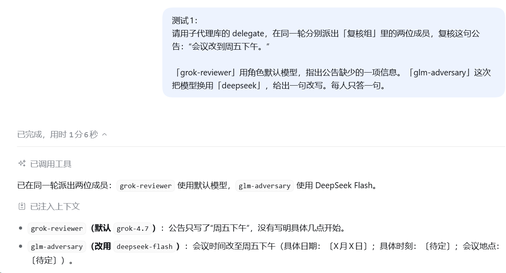

# dsh-subagent-library

**中文 | [English](./README.en.md)**

<p align="center">
  
</p>

<p align="center">
  
  
  
</p>

## 子代理库

把常用的子代理保存在 DeepSeek Harness 的角色名册里。每个角色都有自己的名字、职责和提示词，可以指定模型与思考强度，也可以跟随主会话。配置一次，以后在桌面端或 Web 的对话里直接点名就能派活。

比如，下面这份名册启用了 `glm-adversary`。在主会话里可以直接说：

> 让 `glm-adversary` 看一下这份上线计划，挑出两个最需要提前确认的假设。

主会话用 `list_subagents` 查看你保存的角色，用 `delegate` 把任务交给选中的那一位。角色会作为 DSH 的原生子代理启动，完成后向主会话汇报，你也可以继续追问。



[安装](#安装) · [第一次委派](#第一次委派) · [临时更换模型](#临时更换模型) · [可选功能：编队](#编队成员与分工) · [配置与迁移](#配置与迁移)

## 管理角色名册

在 **设置 → 子代理库 → 角色名册** 中，可以按角色 ID、描述或模型筛选。展开角色卡片即可编辑提示词、默认模型和思考强度。暂时用不到的角色可以停用，配置会保留，随时可以重新启用。

每个角色单独保存为一个 YAML 文件，默认目录是 `~/.dsh/subagents/`。可以在设置页创建，也可以自行编辑文件，或请有目录写入权限的主会话帮你配置。保存后，下次查询和派遣就会用到新配置。桌面端与 Web 可以为同一角色分别配置模型。

0.4.0 面向 DSH `0.2.2-rc.5`，需要宿主支持可按名称继续对话的原生子代理。从旧版升级请参阅[迁移指南](./MIGRATION.md)和[更新日志](./CHANGELOG.md)。

## 安装

### 桌面客户端（推荐）

桌面客户端与 Web 的插件安装和启用状态各自独立；在 Web 安装不会自动在桌面端启用。桌面图形界面安装无需配置 PATH。

1. 打开桌面客户端，进入侧栏 **插件（Plugins）** → **添加插件（Add plugin）**。
2. 输入 npm 包名 `dsh-subagent-library@latest` 并安装。
3. 安装完成后点击 **立即启用（Enable now）**；只关闭安装完成对话框会让插件保持停用。
4. 仅在界面提示需要重启时，通过应用菜单 **退出（Quit）** 完整退出再重开。关闭窗口可能只是隐藏应用。

启用后打开 **设置 → 子代理库**，选择「角色名册」或「编队」。名册目录可在「存储与备份说明」中查看。

<details>
<summary>备用：使用桌面随附 CLI（Windows / macOS）</summary>

先启动桌面客户端一次以完成初始化。在应用菜单打开 **Manage dsh Command…** → **Install**，注册桌面随附的 `dsh` 命令，再打开新终端；若界面报告 PATH 冲突，先按其提示处理。

通过 **Quit** 完整退出桌面客户端后，使用刚注册的桌面随附 CLI：

```sh
dsh plugin --profile desktop add dsh-subagent-library@latest
dsh plugin --profile desktop list
```

完成后重开桌面客户端。npm 安装的 `dsh` 和 `npx` 不能管理 `desktop` profile。命令注册说明见[官方桌面文档](https://github.com/deepseek-ai/deepseek-harness/blob/dsh-v0.2.1-rc.2/apps/desktop/README.md#bundled-command-runtime)。

</details>

### Web

以下命令只管理 Web 的插件。使用启动该 Web 实例的同一套、与宿主版本匹配的 `dsh` CLI，从 npm 安装稳定版本：

```sh
dsh plugin --profile web add dsh-subagent-library@latest
```

安装后停止当前 `dsh web` 进程，用同一套 CLI 重新运行 `dsh web`，再刷新页面。

其他安装来源：

```sh
# 从 GitHub 安装（仓库已提交 lib/ 构建产物，安装无需本地构建）
dsh plugin --profile web add github:MaRi23333/dsh-subagent-library

# 从本地目录安装
git clone https://github.com/MaRi23333/dsh-subagent-library.git
cd dsh-subagent-library
pnpm install && pnpm run build
dsh plugin --profile web add /absolute/path/to/dsh-subagent-library
```

> 仓库已提交 `lib/` 构建产物，git 安装无需本地构建；改源码后运行 `pnpm run build` 再重启 Web。
> 名册（`~/.dsh/subagents/` 下的条目文件）**热生效**，无需重启。
>
> **渠道切换**：之前从 GitHub / 本地目录安装、现在想跟随 npm 发布升级时，用 `dsh plugin --profile web add dsh-subagent-library@latest` 显式取 npm 最新版。

## 第一次委派

1. 打开 **设置 → 子代理库 → 角色名册 → 新建角色**。把 ID 填为 `text-helper`，描述填为「整理主会话提供的短文本」。模型留空，保存后就会跟随主会话模型。
2. 在对话里说：「请用 `text-helper` 把苹果、香蕉、梨按原顺序排成编号列表，整理好后把结果发给我。」
3. 主会话派出角色后，`delegate` 的启动回执会给出成员名。等它汇报后，还可以让同一位成员把列表改成一行。

想先看看自己有哪些角色，可以在命令面板输入 `/subagent`。这里显示保存好的名册。DSH 自带的 `list_agents` 则用来查看已经启动的成员。

<details>
<summary>用 YAML 创建角色，以及第一次派遣时的常见问题</summary>

在名册目录创建 `text-helper.yaml` 可以得到同样的角色。角色 ID 取自文件名，`description` 会显示给主会话，`persona` 会随任务交给子代理。

```yaml
description: 整理主会话提供的短文本。
persona: 保留原文中的专有名词。
```

找不到角色时，在名册中刷新并确认它已启用。主会话看不到 `list_subagents` 或 `delegate` 时，检查当前桌面或 Web 实例是否启用了插件，以及会话能否使用这两个工具。首次尝试可以把角色模型留空，先用主会话已能正常对话的模型派遣。

</details>

## 临时更换模型

假设 `text-helper` 平时跟随主会话，这次想看另一个模型会怎么改，可以直接说：「让 `text-helper` 用 DeepSeek Flash 整理这段文字。」独立角色和编队成员都可以选用当前会话授权的模型。下次照常点名，角色仍用原来的配置。

在 DSH 侧栏打开 **插件 → 内置插件配置 → 子智能体 → 模型选择**，启用「允许 Agent 为子智能体选择模型」。勾选可用模型，保存并新建会话。主会话可用 `list_subagent_models` 查看选项，派遣时传入 `provider` 和 `model`，也可以用 `reasoning_effort` 指定思考强度。

会话没有已记录的模型名单时，显式选模仅可指定父会话当前的渠道和模型。宿主无法提供授权状态时，仍可按角色默认配置派遣。智能体团队开关不影响这两种用法。

## 编队成员与分工

有些任务常常要找同一组人。比如审核公告，一位负责找出遗漏，另一位负责改写。打开 **设置 → 子代理库 → 编队 → 新建编队**，选入已有角色，为每位成员写好分工，也可以写一段大家共用的说明。下次点名这个编队，就能沿用这套分工。



下面是一次实际派遣。主会话在同一轮请 `grok-reviewer` 用默认模型找出公告遗漏的信息，再请 `glm-adversary` 临时用 DeepSeek Flash 给出改写。



每次 `delegate` 启动一位成员。独立任务可以同轮分派，有先后依赖的任务可以等前一位汇报后再派。关闭 DSH 的「智能体团队」也能使用编队，开启后还可使用宿主的共享任务板。

<details>
<summary>编队 YAML 示例与工具调用</summary>

下面的 `text-review` 示例复用上文创建的 `text-helper`。两个成员引用同一角色，分别用 `facts` 和 `questions` 标识各自的分工。将文件保存为名册目录下的 `_groups/text-review.yaml`。

```yaml
description: 整理材料中的事实与待确认事项。
instructions: 发回结论时注明依据。
members:
  - slot: facts
    role: text-helper
    assignment: 提取有原文依据的事实。
  - slot: questions
    role: text-helper
    assignment: 列出需要补充的信息。
```

| 操作 | 主会话调用 |
| --- | --- |
| 浏览编队 | `list_subagents({kind:"groups"})` |
| 查看成员代号、模型配置和分工 | `list_subagents({group_id:"text-review"})` |
| 派一人核对事实 | `delegate({group_id:"text-review", slot:"facts", prompt:"核对刚才这段文字。"})` |

查询不会启动成员。在这个示例中，`questions` 只有被另一次调用明确选中才会启动。直接按角色 ID 派遣只带角色人设与本次任务。从编队点名时，首条子代理消息还会带上编队说明和这位成员的分工。再次派遣时会重新读取当前角色和 profile 路由，已启动的成员继续使用原会话。人类也可以用 `/subagent` 查看名册和编队。

用 `/subagent groups text-review` 可以看到哪些成员指定了模型，哪些跟随主会话。角色也可以跟随主会话模型、单独指定思考等级。派发后，顶部子代理列表和官方 `list_agents` 的成员描述显示启动时的模型与已知思考等级，例如 `text-review/facts [model-a · high]`。展开 `delegate` 回执可以查看完整的模型渠道（`provider`）、模型（`model`）和思考等级（`reasoningEffort`）。宿主未提供的值会省略。

</details>

## 配置与迁移

| 位置或字段 | 行为 |
| --- | --- |
| `<entriesDir>/<role-id>.yaml` | 共享角色，`description` 必填。支持 `persona`、`enabled`、模型路由、`maxTokens`、`maxDepth` 和 `subagentProvider`。 |
| `_profiles/<profile>/<role-id>.yaml` | 当前 profile 的模型路由。可指定 `provider`、`model`、`reasoningEffort` 或显式继承。共享 provider 未在该 profile 注册时沿用会话模型；显式 profile 路由有误会给出诊断。 |
| `_groups/<group-id>.yaml` | 必填组描述和非空、有序的 `members`，可选 `name`、`enabled` 和 `instructions`。每位成员填写代号 `slot` 和角色 `role`，可用 `assignment` 写下默认分工。 |
| `maxDepth` | 不填时采用宿主上限；角色可以进一步收紧，设为 0 时禁止派遣。 |
| `subagentProvider` | 传输默认使用 `spawn`。`fork` 可继承父会话已完成轮次的历史。LLM provider 单独配置。 |
| 旧 `backgroundMode`、`toolFilter` | 旧运行模式统一按异步可续聊执行。带有旧工具限制的角色会保留配置并阻止派遣；确实需要硬限制的角色应先在宿主落实权限。 |

有 profile 的宿主将设置页中的模型修改保存到当前 profile。没有 profile 的宿主可以在同一页编辑共享默认模型，清空后跟随会话。更改共享模型后，绑定旧默认路由的 profile 设置需要重新指定。

角色 ID、编队 ID 和成员代号采用小写字母、数字和短横线，以字母或数字开头，最长 64 字符，并避开 Windows 设备保留名。停用编队后，启用的角色仍可单派。被编队引用的角色需先移除引用才能删除。设置写入保留并发冲突检查，手工修改 YAML 对下次查询和派遣生效。

在当前 profile 的 `cordis.patch.yml` 中可以指定名册位置和默认传输：

```yaml
- id: subagent-library
  config:
    entriesDir: ~/.dsh/subagents
    subagentProvider: spawn
```

备份时一起保留角色、`_profiles/` 和 `_groups/`。设置接口 `/subagent-library/api` 使用 DSH Web Host 的访问边界。将宿主开放给其他设备时，在宿主或反向代理配置访问控制。

## 开发

```sh
pnpm install
pnpm run typecheck
pnpm run build   # host: lib/index.js；client: lib/client.js
```

- 开发依赖仍锁定 DSH `0.1.0-rc.6`（见 package.json devDependencies），不等于当前使用宿主版本。其他版本如接口漂移请对照 [deepseek-harness 仓库](https://github.com/deepseek-ai/deepseek-harness) 相应 tag 调整。

## License

[Apache-2.0](./LICENSE)。本仓库内联构建产物的第三方许可证声明见 [THIRD_PARTY_NOTICES.md](./THIRD_PARTY_NOTICES.md)。

本插件是独立社区项目，与 DeepSeek 无任何隶属或背书关系；`DeepSeek Harness` 名称仅用于标明兼容平台。
